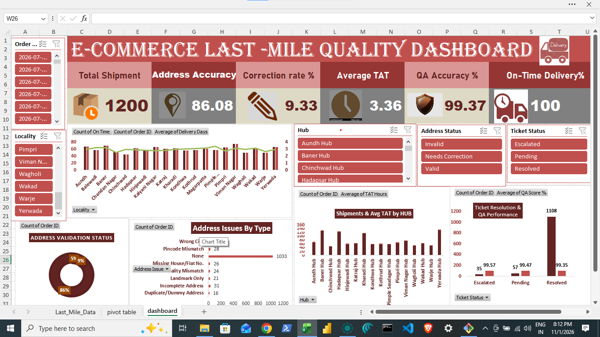

# E-Commerce-Last-Mile-Delivery-Quality-Dashboard-Microsoft-Excel
Developed an interactive E-Commerce Last-Mile Delivery Quality Dashboard using Microsoft Excel. Utilized Pivot Tables, Excel formulas, charts, and slicers to analyze shipment performance, address accuracy, correction rates, average TAT, QA accuracy, on-time delivery, hub performance, and ticket resolution.

E-Commerce Last-Mile Delivery Quality Dashboard | Microsoft Excel

Developed an interactive E-Commerce Last-Mile Delivery Quality Dashboard using Microsoft Excel, leveraging Pivot Tables, Excel formulas, charts, and slicers to analyze delivery operations and quality performance.

The dashboard provides insights into key performance indicators (KPIs), including Total Shipments, Address Accuracy, Correction Rate, Average Turnaround Time (TAT), QA Accuracy, and On-Time Delivery Percentage.

Key Features:
- Interactive dashboard with dynamic slicers and filters.
- Shipment and delivery performance analysis by locality and hub.
- Address validation status and address issues analysis.
- Ticket resolution and QA performance tracking.
- Hub-wise shipment volume and average TAT analysis.
- KPI cards for monitoring delivery quality and operational efficiency.
- Data analysis and visualization using Excel Pivot Tables, formulas, and charts.
Tools & Technologies: Microsoft Excel, Pivot Tables, Excel Formulas, Charts, Slicers, Data Analysis & Visualization.
